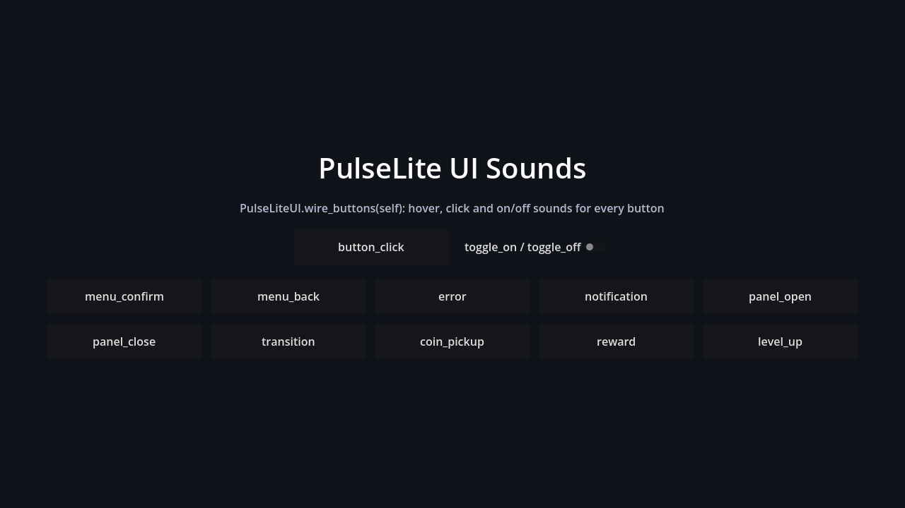

# PulseLite UI Sounds for Godot 4

**Try the sounds in your browser:** [PulseLite UI Sound Previewer](https://bigshadex.github.io/pulselite-previewer/), a mock game menu playing all 20 free sounds plus three clearly labelled samples from each paid style.

A small Godot 4 add-on that gives your menus consistent interface sounds. It ships a <code>PulseLiteUI</code> autoload and 20 matching free sounds: click, hover, toggle, confirm, back, error, notification, panel open/close, transition, coin, reward, and level up.

Tested on Godot 4.7.2. GDScript only; no dependencies.

## Install

- **Godot AssetLib:** search for “PulseLite UI Sounds” and install it into your project.
- **Manual install:** copy the addons/pulselite_ui/ folder from this repository into your project’s addons/ folder.

Then enable **PulseLite UI SFX (free sample)** under *Project > Project Settings > Plugins*. Enabling the plugin registers the <code>PulseLiteUI</code> autoload. You can instead add res://addons/pulselite_ui/PulseLiteUI.gd as an autoload named PulseLiteUI.

## Quick start

Wire the buttons under a scene node, then call an event from any script:

    func _ready() -> void:
        # Buttons get hover and press sounds; toggle buttons get on/off sounds.
        PulseLiteUI.wire_buttons(self)

    func _on_coin_collected() -> void:
        PulseLiteUI.play("coin_pickup")

<code>PulseLiteUI.play(event)</code> returns the AudioStreamPlayer used, or null when the event has no available file. <code>PulseLiteUI.wire_buttons(root, hover = true)</code> handles the root button and its descendant buttons. Toggle-mode buttons play <code>toggle_on</code> and <code>toggle_off</code>.

To include buttons created later, call <code>PulseLiteUI.enable_auto_wire()</code>. Per-button metadata can change or skip the press sound:

    button.set_meta("pulselite_event", "menu_back")
    button.set_meta("pulselite_ignore", true)

The free add-on maps the events to the 20 sounds included here. Its <code>base_path</code> defaults to <code>res://addons/pulselite_ui/sounds/</code> and <code>extension</code> defaults to <code>wav</code>, the format shipped with this repository.

Other available controls are <code>PulseLiteUI.preload_all()</code>, <code>PulseLiteUI.stop_all()</code>, and the <code>played(event, path)</code> signal. Settings are <code>bus</code> (defaults to <code>UI</code>, with fallback to <code>Master</code>), <code>volume_db</code>, <code>pitch_jitter</code>, <code>random_variation</code>, <code>no_repeat</code>, and <code>hover_cooldown_ms</code>. The player has eight overlapping voices, rate-limits hover sounds, and keeps working while the game is paused. Melodic events (notification, reward, and level_up) are not pitch-shifted.

## Events

| Event | Sound category |
|---|---|
| <code>button_click</code> | click |
| <code>button_hover</code> | hover |
| <code>toggle_on</code> | toggle |
| <code>toggle_off</code> | toggle |
| <code>menu_confirm</code> | confirm |
| <code>menu_back</code> | back/cancel |
| error | error |
| <code>notification</code> | notify |
| <code>panel_open</code> | panel open |
| <code>panel_close</code> | panel close |
| transition | whoosh |
| <code>coin_pickup</code> | coin |
| reward | reward |
| <code>level_up</code> | level up |

<code>addons/pulselite_ui/ui_events.json</code> contains the same event map for use outside the autoload. The sounds are 44.1 kHz, 16-bit mono WAV, loudness-matched with peaks at or below -1 dBFS.

## Demo

The included project opens in Godot. Run it to try <code>demo/demo.tscn</code>, with one button per event wired by <code>PulseLiteUI.wire_buttons(self)</code>. Only <code>addons/pulselite_ui/</code> is needed in your own project.

Optional: [PulseLite Free preset for Maaack’s UI Sound Controller](addons/pulselite_ui/integrations/maaack/README.md) adds ready-made stream assignments to Maaack’s existing controller. That scene requires Maaack’s plugin; the standard PulseLite add-on remains independent.

## Packs

The linked paid downloads have their current prices and full licence terms on itch.io. WAV and OGG copies are alternate formats of the same recordings; the format copies are not counted as extra sounds.

- **Menu Kit:** 200 recordings across 13 sound categories mapped to 14 named UI events (toggle has 8 on and 7 off sounds); WAV and OGG; Godot 4 and Unity helper scripts. [View Menu Kit on itch.io](https://bigshadex.itch.io/pulselite-ui-sfx)
- **Sci-Fi UI:** 104 recordings across the same 14 named events; WAV and OGG; Godot 4 and Unity helper scripts. [View Sci-Fi UI on itch.io](https://bigshadex.itch.io/pulselite-scifi-ui)
- **Horror UI:** 104 recordings across the same 14 named events; WAV and OGG; Godot 4 and Unity helper scripts. [View Horror UI on itch.io](https://bigshadex.itch.io/pulselite-horror-ui)
- **PulseLite Complete:** all three paid packs, with 408 distinct recordings in total (200 Menu + 104 Sci-Fi + 104 Horror), in WAV and OGG formats. [View Complete on itch.io](https://bigshadex.itch.io/pulselite-complete)

Paid downloads include Unity helper scripts that are compile-checked but have not been tested inside the Unity editor; they are not included in this free Godot repository. The browser preview plays the free 20-sound mock menu or three listening-only teasers from the selected paid style. It does not audition every sound in a paid pack.

## Tests

The native headless checks run the add-on without Maaack and then verify the optional Maaack preset. The standalone checks use a disposable project with the real <code>PulseLiteUI</code> autoload registered and cover button signals, metadata overrides, toggles, playback settings, and safe missing-event or missing-file results. CI runs both checks on Godot 4.3 and 4.7.

On Linux or WSL, fetch the checksum-pinned QA inputs and run one engine version like this:

    python3 tests/fetch_maaack_qa.py --godot-version 4.7 --output /tmp/pulselite-qa
    python3 tests/run_maaack_checks.py --godot /tmp/pulselite-qa/Godot_v4.7-stable_linux.x86_64 --controller-source /tmp/pulselite-qa/maaack/ui_sound_controller.gd

## Licenses

- **Code** (<code>plugin.gd</code>, <code>PulseLiteUI.gd</code>, <code>ui_events.json</code>, the demo): MIT, see [LICENSE](LICENSE).
- **Sounds** (<code>addons/pulselite_ui/sounds/</code>): [CC BY 4.0](https://creativecommons.org/licenses/by/4.0/),
  see [LICENSE-SOUNDS](LICENSE-SOUNDS). Attribution is required, for example in your credits:

  > PulseLite UI SFX by Bigshadex (https://bigshadex.itch.io/pulselite-ui-sfx-free), CC BY 4.0

Copies of both licenses are also inside <code>addons/pulselite_ui/</code> so they travel with the add-on.

## How it was made

The audio is synthesized from code (procedural DSP: oscillators, FM, filtered noise, envelopes). No recorded samples, sample libraries, or AI-generated audio. The GDScript and documentation were written with AI assistance, then tested and reviewed.

## Links

- Browser previewer: https://bigshadex.github.io/pulselite-previewer/
- Free sample with a playable browser demo: https://bigshadex.itch.io/pulselite-ui-sfx-free

## Optional feedback and other products

If you've tried this free add-on and would like to leave a rating or short review on its itch.io page, an honest one is welcome. Positive, mixed, or critical feedback is useful; no pressure. If you haven't tried the add-on, please skip rating it. The add-on is free to use, and no purchase or rating is required.

**Also by Bigshadex:** [Menu Kit](https://bigshadex.itch.io/pulselite-ui-sfx), [Sci-Fi UI](https://bigshadex.itch.io/pulselite-scifi-ui), [Horror UI](https://bigshadex.itch.io/pulselite-horror-ui), and [PulseLite Complete](https://bigshadex.itch.io/pulselite-complete). The separate [Client Tracker](https://bigshadex.itch.io/client-tracker) is a manual-entry spreadsheet for client, project, invoice, payment, and follow-up records; it is not part of this Godot add-on.
