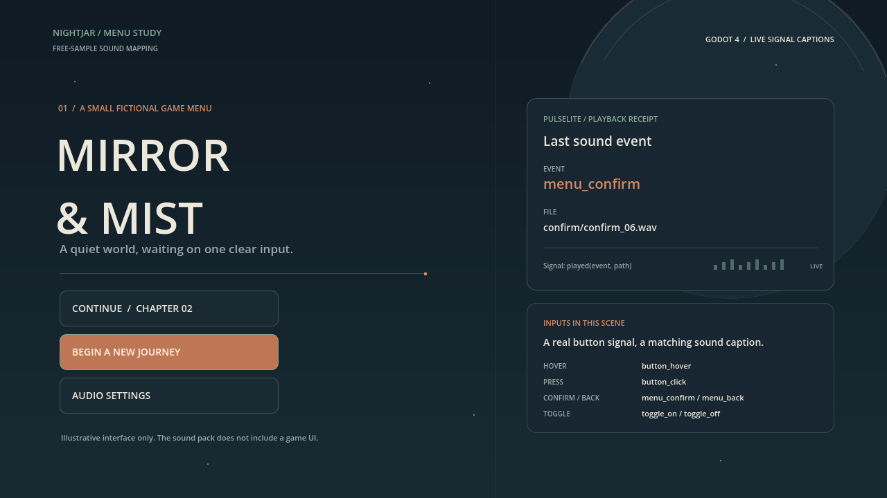

# PulseLite UI signal demo

These assets show a small fictional menu using the existing free-sample sound files. The menu is illustrative only; the addon does not include a game UI. The event and file captions update from the addon's real `PulseLiteUI.played(event, path)` signal.

`01-main-menu.png`, `02-confirm-signal.png`, and `03-options-toggle.png` are Godot viewport captures. `pulselite-menu-demo.gif` is a 7.6-second, nine-frame silent animation made from the same capture run. The capture scene injects synthetic viewport mouse events to exercise Godot button signals; that is not a physical pointer test. It was rendered with the Dummy audio driver, so these assets do not demonstrate audible playback.

Only the sounds already included in the free sample addon are used. No paid-theme variants are shown. Sound attribution: **PulseLite UI SFX by Bigshadex** ([free sample](https://bigshadex.itch.io/pulselite-ui-sfx-free)), licensed under [CC BY 4.0](https://creativecommons.org/licenses/by/4.0/). See the repository's `LICENSE-SOUNDS` for the complete attribution terms.

The 20 public WAVs were also compared byte for byte with the current uploaded Menu Kit ZIP (`PulseLite-UI-SFX-Pack-with-extras.zip`, SHA-256 `4bb96826023999de8109df45ef222c10d990947ae2071c004fb3ab8e00445b73`): all match. These assets can illustrate those shared Menu Kit sounds; they do not preview the Sci-Fi or Horror recordings.



## Reproduce

Use a disposable Godot project containing this repository's `project.godot`, `addons/pulselite_ui/`, and `demo/` directories, along with `marketing/visuals/`. Import the copied project before starting capture so Godot has imported the WAV resources:

```text
godot --path <scratch-project> --editor --import --quit
```

Then run the scene with `--asset-dir`, `--frame-dir`, and `--trace-file` user arguments. These direct the three stills, nine intermediate frames, and the JSONL `played` trace to the requested locations. `encode_gif.py` assembles the nine frames with Pillow already available in the environment:

```text
godot --path <scratch-project> <display-and-renderer-options> res://marketing/visuals/demo.tscn -- --asset-dir=<visuals-directory> --frame-dir=<scratch-project>/frames --trace-file=<scratch-project>/played-events.jsonl
python marketing/visuals/encode_gif.py --frames <scratch-project>/frames --output marketing/visuals/pulselite-menu-demo.gif
```

The supplied captures were made with Godot 4.7.stable. They do not establish support or visual fidelity on other engines, renderers, operating systems, or audio devices.

On the checked WSLg setup, the display options were `--display-driver x11 --rendering-method gl_compatibility --audio-driver Dummy --windowed --resolution 1280x720 --position 5000,1000`. Capture mode sets the no-focus window flag. A separate parent rerender of the unchanged scene succeeded; the driver reported only that changing V-Sync mode was unsupported. All required event types and resource paths were checked in both captures. No addon source or project settings were changed for this scene. Scene and documentation prepared with AI assistance.
